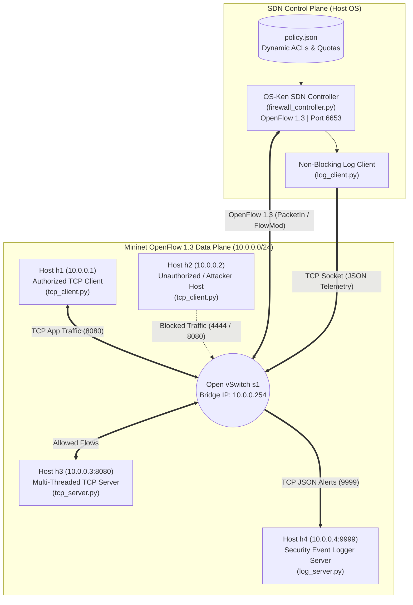

# SDN-Based Dynamic Firewall with Centralized Security Event Logger

An OpenFlow 1.3 Software-Defined Networking (SDN) dynamic firewall and closed-loop TCP security telemetry system built with **OS-Ken**, **Mininet**, **Open vSwitch**, and **Python POSIX TCP Sockets**.

---

## 1. System Architecture & Communication Flow

### Network Addressing Plan
| Node | IP Address | Role & Component | Port / Protocol |
| :--- | :--- | :--- | :--- |
| **c0** | 127.0.0.1 | OS-Ken OpenFlow 1.3 SDN Controller (controller/firewall_controller.py) | 6653/TCP (OpenFlow) |
| **s1** | 10.0.0.254 | Open vSwitch (OVSSwitch) enforcing L3/L4 flow rules | OpenFlow 1.3 |
| **h1** | 10.0.0.1 | Legitimate Client Node (socket_app/tcp_client.py) | Ephemeral TCP |
| **h2** | 10.0.0.2 | Restricted / Attacker Client Node (socket_app/tcp_client.py) | Ephemeral TCP |
| **h3** | 10.0.0.3 | Multi-Threaded Application Server (socket_app/tcp_server.py) | 8080/TCP (Allowed), 4444/TCP (Forbidden) |
| **h4** | 10.0.0.4 | Centralized Security Event Logger (socket_app/log_server.py) | 9999/TCP (JSON Telemetry) |

---

## 2. Running the Full End-to-End Demo (Deliverable 1)

1. **Terminal 1 (Start OS-Ken Controller):**
   source venv/bin/activate && PYTHONPATH=.:controller osken-manager controller.firewall_controller
2. **Terminal 2 (Start Mininet Topology):**
   sudo python3 mininet/topo.py
3. **Inside mininet> CLI (Start Logger on h4 and App Server on h3):**
   mininet> xterm h3 h4
   - On h4: python3 socket_app/log_server.py --host 0.0.0.0 --port 9999
   - On h3: python3 socket_app/tcp_server.py --host 0.0.0.0 --port 8080
4. **Run Automated Logger & Integration Verification Suite:**
   python3 socket_app/test_logger_suite.py
