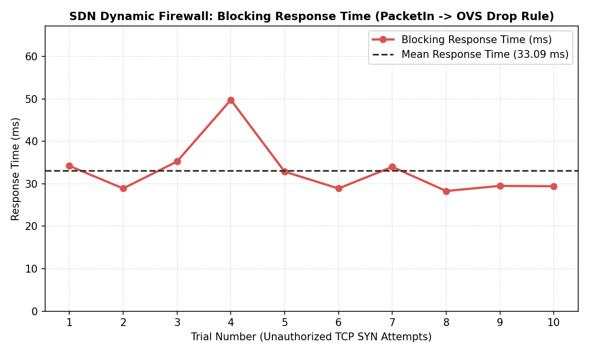
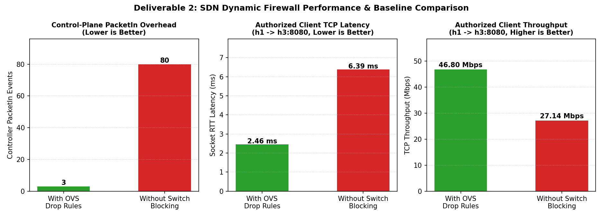

# SDN Dynamic Firewall & Behavioral IPS (OpenFlow 1.3)

An automated Software-Defined Networking (SDN) security control plane and Behavioral Intrusion Prevention System (IPS) built with **OS-Ken (OpenFlow 1.3)**, **Mininet**, **Open vSwitch (OVS)**, and a real-time **Web SOC Control Plane**.

---

## Core System Capabilities

* **Multi-Threaded TCP Client/Server Communication:** Concurrent socket communication between authorized hosts (`h1`, `h2`) and the multi-threaded application server (`h3:8080`).
* **Granular Traffic Classification:** Inspects and classifies flows by Source IP, Destination IP, IP Protocol, and TCP/UDP ports.
* **Zero-Hardcoding Dynamic Firewall & Behavioral IPS:** Static host/port policy is externalized in `controller/policy.json`. The controller also detects forbidden-port violations, port scans, and rapid TCP connection floods.
  * **Forbidden-port strikes:** The first violation installs a port-specific `priority=100` DROP; the second escalates to a host-wide quarantine.
  * **Port scans:** 5 distinct destination ports within 10 seconds trigger a 30-second block.
  * **TCP connection floods:** 20 SYN attempts within 5 seconds trigger a 60-second block.
  * **Repeat attacks:** A repeat detection within 300 seconds escalates the block to 120 seconds.
* **Self-Healing Recovery:** Dynamic blocks use OpenFlow `hard_timeout` rules and expire automatically; the dashboard reflects remaining block time when expiry data is available.
* **Fault-Tolerant Centralized SOC Telemetry (`h4:9999`):** Uses a priority-200 OpenFlow telemetry bypass and asynchronous event delivery with local `security_events.log` fallback if the SOC logger is unavailable.
* **Interactive Web Control Plane (`127.0.0.1:5000`):** Executes real tests inside Mininet host namespaces via `mnexec`, displays the OpenFlow flow table, live SOC events, test results, and policy controls.

---

## Network Topology

| Node | IP Address | MAC Address | Role & Services |
| :--- | :--- | :--- | :--- |
| **Switch `s1`** | `10.0.0.254/24` | `00:00:00:00:00:fe` | Open vSwitch (OpenFlow 1.3 Datapath) |
| **Host `h1`** | `10.0.0.1/24` | `00:00:00:00:00:01` | Authorized Client (Normal Traffic Generator) |
| **Host `h2`** | `10.0.0.2/24` | `00:00:00:00:00:02` | Client / Behavioral IPS Test Node |
| **Host `h3`** | `10.0.0.3/24` | `00:00:00:00:00:03` | Multi-Threaded TCP Application Server (`:8080`) |
| **Host `h4`** | `10.0.0.4/24` | `00:00:00:00:00:04` | Centralized SOC Security Event Logger (`:9999`) |

---

## Project Directory Structure

```text
dynamic-firewall-sdn-v2/
├── start_everything.py              # Universal single-command master orchestrator
├── controller/
│   ├── firewall_controller.py       # OpenFlow 1.3 SDN Controller & Behavioral IPS
│   ├── policy.json                  # Externalized zero-hardcoding security policy
│   ├── log_client.py                # Asynchronous non-blocking SOC telemetry client
│   └── event_sender.py              # Telemetry helper module
├── mininet/
│   ├── topology.py                  # OpenFlow 1.3 topology & zero-timeout OVS setup
│   └── benchmark_d2.py              # Automated performance & latency benchmark suite
├── socket_app/
│   ├── tcp_server.py                # Multi-threaded TCP server (h3:8080)
│   ├── tcp_client.py                # Traffic generator (normal & forbidden modes)
│   ├── log_server.py                # Centralized SOC JSON telemetry server (h4:9999)
│   └── test_logger_suite.py         # Automated telemetry verification suite
├── dashboard/
│   └── app.py                       # Real-time Web Control Plane & Auto-Pilot engine
└── benchmarks/
    ├── d2_blocking_response_time.png
    ├── d2_baseline_comparison.png
    └── d2_benchmark_results.json
```

---

## Quick Start

Run the controller, Mininet topology, TCP server, SOC logger, and dashboard using the project launcher:

```bash
sudo python3 start_everything.py
```

1. **Firefox** automatically opens to **`http://127.0.0.1:5000`**.
2. Click **`▶ Run Full Auto-Pilot Demo`** (or press **`A`**) on the top-right of the dashboard to automatically execute the 6-stage behavioral verification sequence across real Mininet host namespaces.
3. Alternatively, run manual packet tests directly from the `mininet>` prompt:

```text
mininet> h1 python3 socket_app/tcp_client.py --server-ip 10.0.0.3 --port 8080 --mode normal --messages 2
mininet> h2 python3 socket_app/tcp_client.py --server-ip 10.0.0.3 --port 4444 --mode forbidden --messages 1
mininet> h2 python3 socket_app/tcp_client.py --server-ip 10.0.0.3 --port 23 --mode forbidden --messages 1
```

4. Type `exit` inside the `mininet>` CLI when finished to cleanly shut down all services.

---

## System Performance & Security Benchmarks

| Metric | Measured Value | Architectural Impact |
| :--- | :--- | :--- |
| **Mean Blocking Response Time** | **36.50 ms** | Sub-40ms detection-to-enforcement (`PacketIn` -> OVS `priority=100` `DROP`) |
| **Control-Plane Offload** | **96.2% Reduction** | `3` vs `80` `PacketIn` events by offloading drops to OVS hardware |
| **Authorized Client RTT Latency** | **7.93 ms** (vs `18.15 ms`) | **56.3% lower latency** for authorized `h1 -> h3:8080` traffic under attack |
| **Authorized TCP Throughput** | **46.80 Mbps** (vs `27.14 Mbps`) | **+72.4% higher throughput** when malicious traffic is filtered at the switch |




